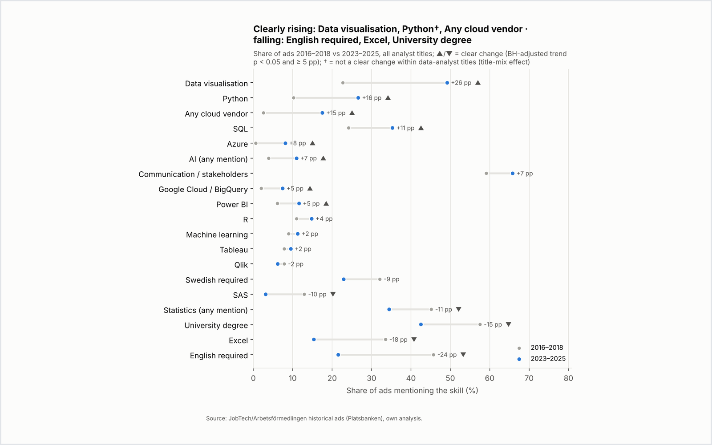
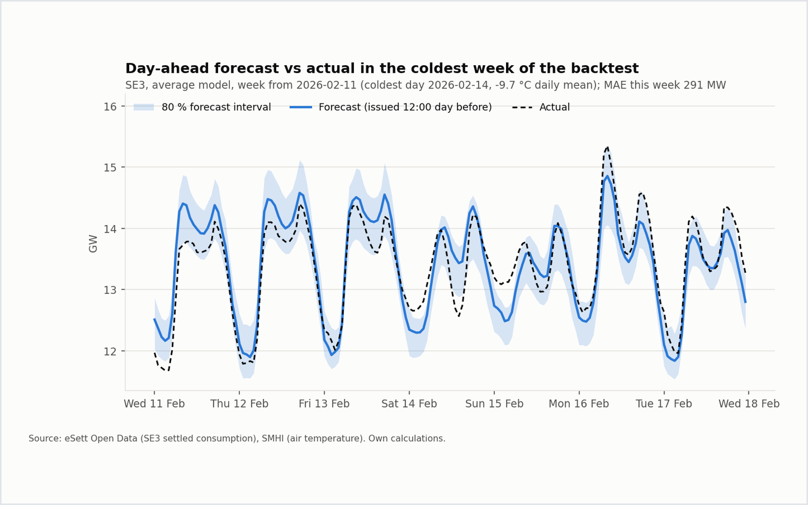
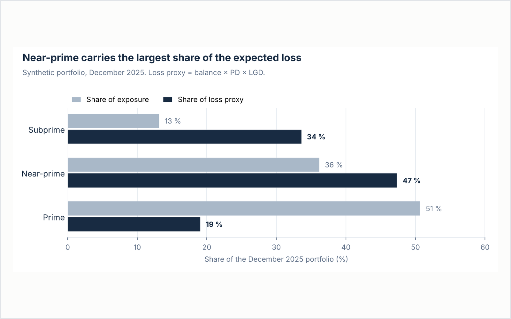
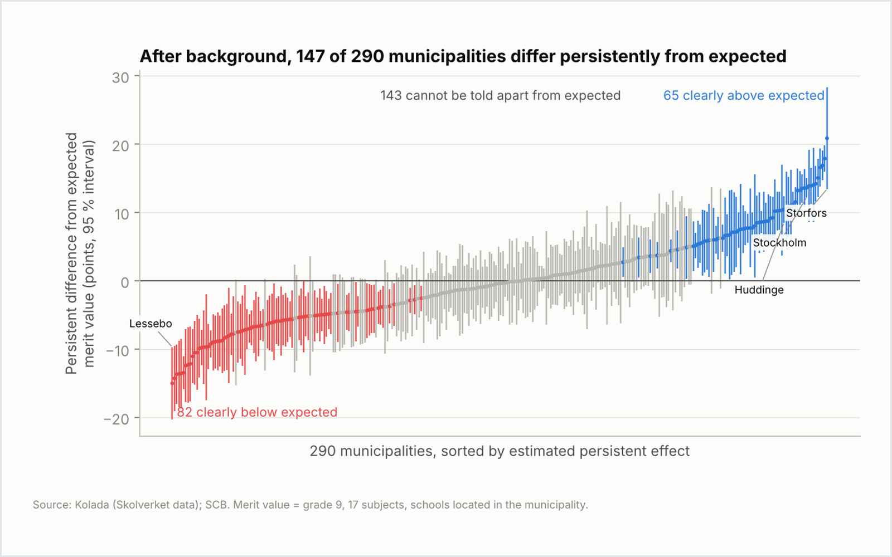
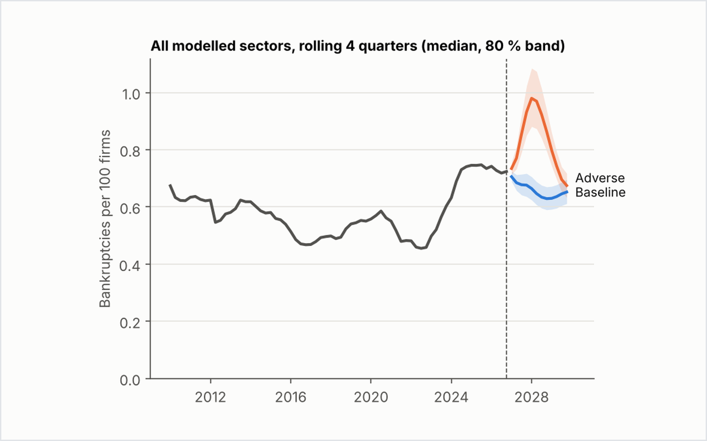
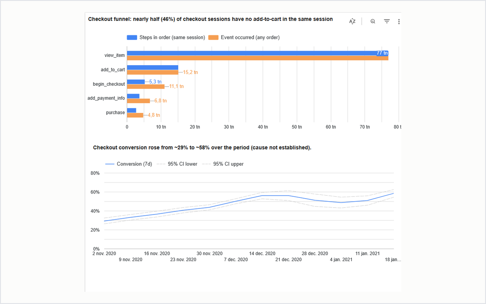

# Data analytics portfolio

**Statistics graduate looking for a Data Analyst role in Stockholm.**

<table>
<tr>
<td width="50%" valign="top">

<h3><a href="https://github.com/davka99/analyst-skills-demand">What do Swedish employers ask of data analysts?</a></h3>

<b>Python, cloud and dashboards are rising; Excel and SAS are falling</b>, in 3,641 job ads from 2016–2025.

Python · text analysis · bootstrap · Arbetsförmedlingen data

<a href="https://github.com/davka99/analyst-skills-demand"><b>View project →</b></a>

</td>
<td width="50%" valign="top">

<h3><a href="https://github.com/davka99/se3-load-forecast">Can tomorrow's electricity use be forecast at noon today?</a></h3>

<b>65 % less error than the simple "same hour last week" rule</b>, tested on a full year the model never saw.

Python · scikit-learn · time series · eSett and SMHI data

<a href="https://github.com/davka99/se3-load-forecast"><b>View project →</b></a>

</td>
</tr>
<tr>
<td width="50%" valign="top">

<h3><a href="https://github.com/davka99/credit-risk-portfolio-analysis">Where does the expected loss sit in a loan book?</a></h3>

<b>Mid-risk customers hold 36 % of the lending but 47 % of the expected loss</b> (synthetic loan data).

Python · SQL · Power BI and DAX

<a href="https://github.com/davka99/credit-risk-portfolio-analysis"><b>View project →</b></a>

</td>
<td width="50%" valign="top">

<h3><a href="https://github.com/davka99/kommun-school-benchmark">Are municipal school rankings signal or noise?</a></h3>

<b>147 of 290 municipalities really differ from expected</b>, but a single year's change is mostly chance.

Python · mixed models · SQL · Kolada data

<a href="https://github.com/davka99/kommun-school-benchmark"><b>View project →</b></a>

</td>
</tr>
<tr>
<td width="50%" valign="top">

<h3><a href="https://github.com/davka99/se-bankruptcy-stress-scenarios">How much could bankruptcies rise in a downturn?</a></h3>

<b>From 0.72 to 0.98 per 100 firms in a stress scenario</b>; restaurants and construction are hit hardest.

Python · count models · scenario analysis · Quarto

<a href="https://github.com/davka99/se-bankruptcy-stress-scenarios"><b>View project →</b></a>

</td>
<td width="50%" valign="top">

<h3><a href="https://github.com/davka99/ga4-funnel-experiment">Where do online shoppers drop out?</a></h3>

<b>44 % of shoppers who start checkout buy within a week</b>; a simulated A/B test says "not yet" for a shorter checkout.

BigQuery · dbt · SQL · Python · Looker Studio

<a href="https://github.com/davka99/ga4-funnel-experiment"><b>View project →</b></a>

</td>
</tr>
</table>

**Tools:** Python · SQL · Power BI · dbt · BigQuery

